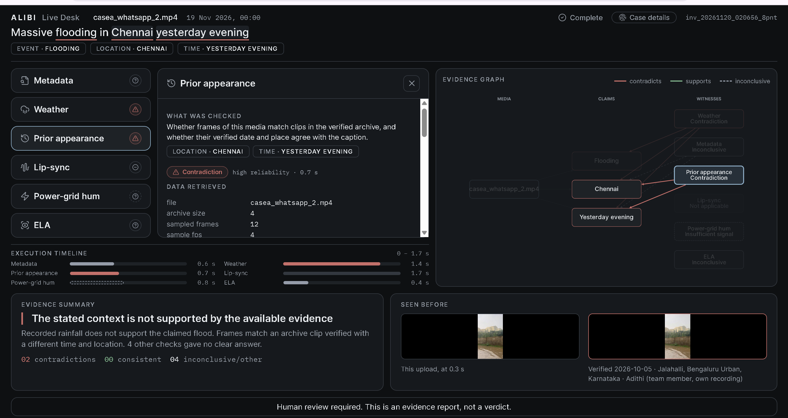
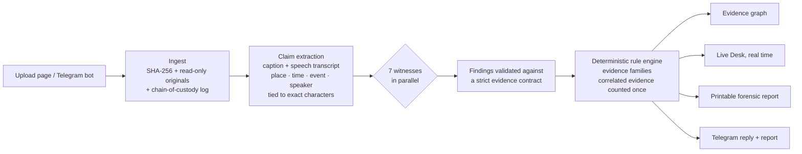
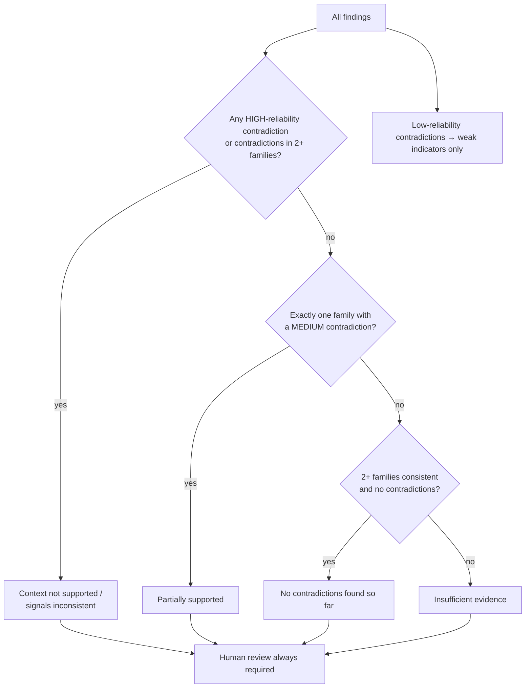

# ALIBI.

### Every piece of media has an alibi. We check whether it holds up.

**Explainable multimodal media verification.** Team **“Pick Me”**, SapthaHacks 2026 (InnovEdge), **Problem Statement 04: TruthLens**

    

**[Live app](https://alibi-xi.vercel.app)** · **[Demo video](https://www.linkedin.com/posts/sampurna-ghosh-a832592b9_sapthahacks26-hackathon-digitalforensics-ugcPost-7529362493727576064-KTqE/?highlightedUpdateUrn=urn%3Ali%3Aactivity%3A7529362595926052864&highlightedUpdateType=SOCIAL_SHARE&origin=SOCIAL_SHARE&utm_source=social_share_send&utm_medium=member_desktop_web&rcm=ACoAAExjv8MBDYuxiXASxqjQBqIdwVIV6wUMFyc)** · **[Setup guide](docs/SETUP.md)**

---

## The problem

Most viral misinformation isn't a deepfake. It's **real footage with a false story**: an old flood video reshared as "today in Chennai", a genuine clip given a new place and date. A pixel-level deepfake detector calls that footage authentic, because it is. The lie lives in the **context**: where, when, what and who.

## What ALIBI does

ALIBI treats every kind of evidence as a **witness**: the caption, the file's metadata, historical weather records, earlier appearances of the same footage, the audio, and lip movement. A **deterministic rule engine** cross-examines those witnesses against the claims the media makes and produces an **explainable forensic report**: what is consistent, what contradicts, what is inconclusive, why, from which evidence, and what else could explain it.

> **It is an evidence report, not a verdict.** Human review is required on every result.

## AI & manipulation check

Upload any **image, video or audio** file, with or without a caption, and ALIBI answers the question first: **"Is this media AI-generated or manipulated?"**

- **AI: DETECTED** when the file carries an AI-provenance marker: C2PA content credentials naming an AI tool, IPTC `DigitalSourceType = trainedAlgorithmicMedia / compositeSynthetic`, or generator tags (DALL·E / ChatGPT, Midjourney, Adobe Firefly, Stable Diffusion, Imagen, Gemini). ALIBI names the exact tool.
- **AI SIGNALS: STRONG / WEAK** from the synthetic-signals witness: periodic peaks in the noise-residual spectrum, missing sensor noise and the camera signature (images), abrupt frame changes and flicker (video), and cloned-speech indicators in the audio (near-digital silence, a hard bandwidth limit, spectral flatness). Signals, never a verdict, with the reasons shown.
- **EDITED: DETECTED** when editing-software traces are present.
- **AI: NOT DETECTED** when none of these is found. ALIBI never calls media "real": most AI-generated media carries no marker, so a missing marker is reported as exactly that.

It also **localises possible pasted-in regions**: a block-wise noise-inconsistency map boxes the region whose noise level differs most from the rest of the picture, cross-checked against error-level analysis.

With a caption, ALIBI then cross-examines the **story** (place, time, event) against the evidence. **Spoken claims count too:** the first 30 s of speech are transcribed on the device (faster-whisper tiny, CPU), and place/time/event claims in the transcript are checked like caption claims, each tied to its exact characters in the transcript.

## Results we measured

| | |
|---|---|
| **Case A: genuine clip, false caption** ("Massive flooding in Chennai yesterday evening") | **Prior appearance: contradiction (high).** 12 of 12 sampled frames match a clip verified as recorded in Jalahalli, Bengaluru on 5 Oct 2026: **296 km and 44 days** from the claim. **Weather: contradiction (medium).** 0.0 mm of rain in Chennai that evening, at all 4 surrounding points, and over the previous 72 h. → *"The stated context is not supported by the available evidence."* |
| **Live test: a lie on a fresh phone clip** ("Heavy flood in Delhi yesterday", recorded minutes earlier in Bengaluru, sent via Telegram) | **Metadata: contradiction.** The capture time falls outside the claimed window (18.6 h after it in our replay). **Weather: contradiction.** No recorded rain in Delhi. Total: **≈ 6 s** on a laptop, streamed live. |
| **Weather witness isn't biased** | The same witness confirms the real Chennai floods of 2 Dec 2015 (**57.9 mm** in the window, **119.2 mm** over 72 h → consistent). |
| **Validation** | **389 automated tests** · **0 false contradictions** on genuine control clips never used for tuning · **≈ 3.6 s** median per investigation (57 runs) · **₹0** runtime cost, offline-capable |

## How it works

**The LLM never decides truth.** Verdicts come from deterministic code and transparent rules. The default runtime uses no LLM at all (rules + templates), works offline and costs nothing.

### The seven witnesses

| Witness | Family | What it checks | Technique | Max reliability |
|---|---|---|---|---|
| Metadata integrity | Context | Capture time and GPS vs the claim; AI-provenance markers; editing and re-encode traces | ExifTool + ffprobe; timezone-aware window rule (±12 h); C2PA / IPTC parsing | Medium |
| Weather | Context | Was it raining where and when the caption claims? | Open-Meteo historical data; 5-point grid (±15 km) + 72 h history | Medium |
| Prior appearance | Context | Has this footage appeared before, with a verified date and place? | Perceptual hashing (pHash) of sampled frames; Hamming distance ≤ 8 | High |
| Lip-sync indicator | Signal | Do mouth movements match the audio? | MediaPipe face landmarks vs audio envelope; windowed cross-correlation | Low (never accuses) |
| Power-grid hum (ENF) | Signal | 50/60 Hz mains hum in the audio | STFT spectral SNR | Display only |
| Error-level analysis | Pixels | Compression differences in images and keyframes | JPEG re-save difference heatmap | Low (visual aid) |
| Synthetic signals | Pixels | Traces of generation and compositing in images, video and speech | Noise-residual spectrum, sensor noise, camera signature, splice map, frame-change spikes, audio spectrum | Medium (contradiction only when both pixel signals are strong and no camera fields exist) |

### How the rule engine decides

## Honesty by design

Two witnesses **failed our own tests**, so ALIBI doesn't let them accuse:

- **Power-grid hum (ENF):** on 5 genuine iPhone recordings, the best cleared our threshold in **43% of frames** (60% required). One showed a spurious 60 Hz trace, which the rules correctly ignored. → Always *"insufficient signal"*: it can't accuse, and it can't vouch.
- **Lip-sync:** calibrated on 5 close-up genuine clips and tested on 5 held-out ones plus swapped-audio clips. No threshold separated them, and our genuine source even scored *less* in sync (**0.103**) than the swap (**0.193**). → Shown for human review, never a contradiction.

**Absence of evidence is never evidence of fabrication.** Missing metadata, no hum or no archive match is always *inconclusive*, and every finding must list its **alternative explanations** and **limitations**. The schema rejects any finding that doesn't.

## PS04 compliance

| PS04 capability | Delivered in ALIBI |
|---|---|
| Image authenticity | AI-provenance markers (C2PA, IPTC source type, generator tags), editing traces, error-level analysis, archive frame matching |
| Video forensics | Lip-sync synchrony, keyframe ELA, frame-by-frame archive matching |
| Audio and voice analysis | Power-grid hum (ENF) analysis, audio-visual synchrony |
| Text and context analysis | Claims tied to exact caption characters, checked against weather, archive and metadata |
| Cross-modal correlation | Evidence graph and evidence families; correlated evidence counted once |
| Manipulation indicators | Flagged regions, frames, timestamps and metadata observations |
| Confidence and uncertainty | Reliability per finding; alternatives and limitations mandatory |
| Forensic report and traceability | Printable report, SHA-256 chain of custody, full analysis history |
| Preserve evidence, human review | Read-only originals; "Human review required" on every surface |

## The forensic report

Every investigation exports a printable report covering everything PS04 §05 asks for: **flagged evidence** (regions, frames, timestamps, matched frame pairs), the **indicator** and why it was flagged, **cross-modal context**, **confidence** with limitations, the **source trace** (SHA-256 of each original, read-only storage, millisecond-stamped history) and a **summary** with recommended human checks.

## Try it

- **Web app:** [alibi-xi.vercel.app](https://alibi-xi.vercel.app). Upload any image, video or audio file (caption optional) for the AI & manipulation check, add a caption to verify its story, or press **Case A**. (The analysis server runs on our forensic workstation during the event.)
- **Live Desk:** the big-screen investigation room, linked from the app header.
- **Telegram:** send a file (5–8 s clip or image) **as a File**, with or without a caption, to the team's verification bot and get the findings and the report back.
- **Run it yourself:** see [docs/SETUP.md](docs/SETUP.md).

## Known limitations

- **No trained AI-image classifier.** The two permissively licensed ONNX detectors we tried did not qualify: one failed calibration (genuine control frames scored higher than our AI images), and the other could not be downloaded and verified within our time limit on venue Wi-Fi. AI detection rests on provenance markers and signal-level indicators.
- **Signal-level AI indicators are weak on re-encoded images.** On our 5 AI test images, 4 show "AI SIGNALS: WEAK" and none "STRONG": re-saving as WebP/JPEG removes the spectral traces. The noise thresholds are tuned on very few genuine photos.
- **Speech-to-text** is wired and tested (with a mocked model), but the 75 MB "tiny" model did not finish downloading on venue Wi-Fi within our time limit, so on our workstation transcription is currently skipped with a stated limitation. Run `scripts/download_models.py` to enable it. It covers the first 30 s and can mishear place names.
- **Lip-sync and power-grid hum never accuse** (see Honesty by design), and the verified archive is small.

## Tech stack

**Backend:** Python 3.12, FastAPI, Pydantic v2 · **Analysis:** OpenCV, MediaPipe, librosa, imagehash, ExifTool, FFmpeg, faster-whisper · **Data:** Open-Meteo · **Frontend:** Next.js, TypeScript, Tailwind, React Flow · **Live Desk:** vanilla JS + Cytoscape.js (fully offline) · **Bot:** Telegram Bot API · **Deploy:** Vercel (frontend) + workstation backend through a Cloudflare tunnel; Dockerfile included.

## Roadmap

Reverse-image search and fact-checker database integration · sun-shadow time-of-day estimation · voice briefings to on-duty reviewers in Indian languages · lip-sync calibrated on larger datasets.

## Team “Pick Me”

**Sampurna Ghosh** (lead: evidence contract, rule engine, integration, Live Desk, bot) · **Mohammed Nooman** (lip-sync, ENF, prior appearance, calibration) · **Adithi Bhat** (metadata, weather, verified archive) · **Dhruva Prasad BV** (web frontend)

## Licence

Code: MIT ([LICENSE](LICENSE)). Third-party components, Open-Meteo data (CC BY 4.0) and team-recorded demo media: [THIRD_PARTY_NOTICES.md](THIRD_PARTY_NOTICES.md).
